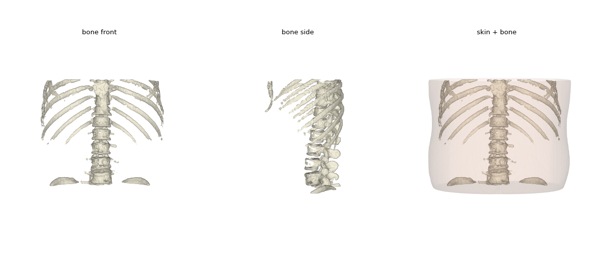
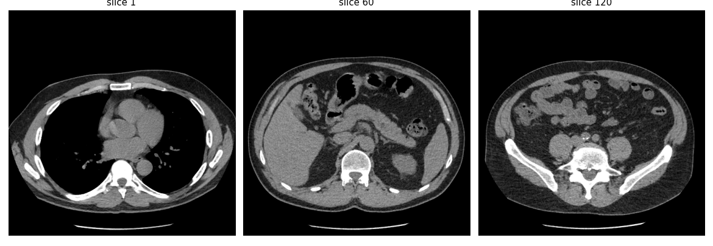

# DICOM CT to 3D Reconstruction

Load a CT series from DICOM files, build a 3D volume, and reconstruct interactive
3D surfaces (skin and bone) with marching cubes. Runs in Google Colab.

## What it does

1. **Load** the DICOM slices with `pydicom`
2. **Stack** them (sorted by physical position, not file name) into a 3D block of Hounsfield units
3. **Resample** to isotropic 2 mm voxels, so later smoothing and morphology act equally in all directions
4. **Mask** the body (largest non-air blob) and bone (dense voxels inside the body)
5. **Extract surfaces** with marching cubes (`scikit-image`)
6. **Display** an interactive mesh with `plotly`

## Run it

Open `notebooks/dicom_3d_colab.ipynb` in Google Colab (File > Upload notebook) and run the two cells.
Set `DICOM_DIR` to the folder that contains your `.dcm` files.

Local run: `pip install -r requirements.txt`, then run the pipeline cell as a script.

## Data

Not included in this repository. The example uses a CT series from the
**CPTAC-CCRCC** collection on [The Cancer Imaging Archive (TCIA)](https://www.cancerimagingarchive.net),
distributed under CC BY 4.0: https://doi.org/10.7937/K9/TCIA.2018.OBLAMN27

Download with the TCIA / NBIA Data Retriever and read the collection's license and
data usage policy first. The images in `images/` are derived from that data.

## Settings worth trying

| Setting | Effect |
|---|---|
| `ISO` | Voxel size in mm. Smaller means more detail, slower |
| `BONE_HU` | Bone threshold in Hounsfield units (try 150 to 400) |
| `AIR_HU` | Body/air threshold |

## Limitations

- Threshold-based surfaces show only high-contrast structures (bone, body outline).
  Showing organs or tumors needs a segmentation model.
- For education and research only. Not for clinical use.

## Citation

If you use TCIA data, cite the dataset and:
Clark K, et al. *The Cancer Imaging Archive (TCIA): Maintaining and Operating a Public
Information Repository.* Journal of Digital Imaging 26(6):1045-1057, 2013.
(Check the collection page for its exact citation text.)
